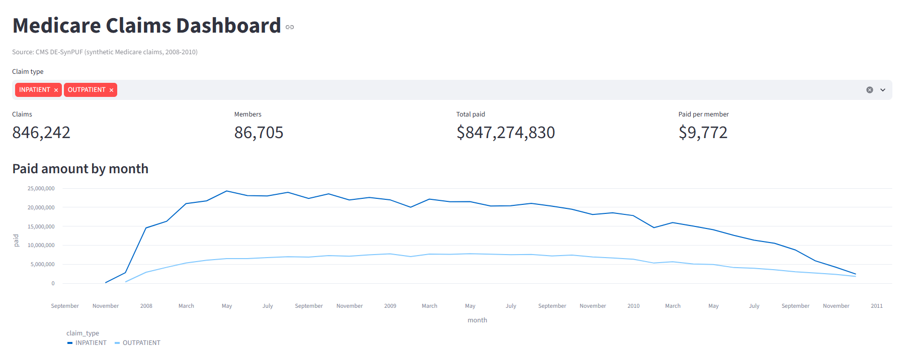
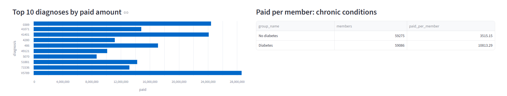
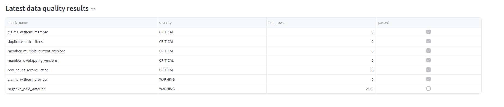
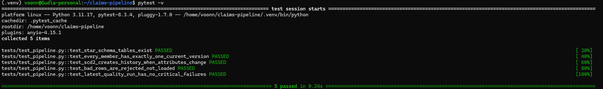

# Medicare Claims Data Pipeline

An end-to-end batch data engineering project built on synthetic Medicare claims
(CMS DE-SynPUF). It ingests raw claim files, cleanses them with PySpark, models
them into a star schema with SCD Type 2 in DuckDB, validates them with automated
data quality checks, orchestrates everything in Apache Airflow, and serves a
Streamlit dashboard. CI runs the whole pipeline on every push.

**Cost: $0.** No cloud account needed.

## Architecture

```
CMS zip files ─► data/landing ─► ingest.py ─► data/raw (CSV)
                                                  │
                                         transform.py (PySpark)
                                     cleanse · type · dedup · reject bad rows
                                                  │
                                         data/staged (Parquet, partitioned by year)
                                                  │
                                       load_warehouse.py (DuckDB)
                     dim_date · dim_member (SCD2) · dim_provider · fact_claims
                                                  │
                                       quality_checks.py ─► dq_results
                                                  │
                                       Streamlit dashboard

Orchestration: Airflow DAG (branch: new files → ingest, else reprocess raw)
CI: GitHub Actions runs the pipeline on sample data + pytest on every push
```
## Dashboard



## Data quality results



## Project structure

```
claims-pipeline/
├── scripts/
│   ├── config.py            shared paths
│   ├── ingest.py            step 1: unzip landing files into raw, write manifest
│   ├── transform.py         step 2: PySpark cleansing → Parquet
│   ├── load_warehouse.py    step 3: DuckDB star schema + SCD Type 2
│   └── quality_checks.py    step 4: DQ checks, fails on critical errors
├── dags/claims_pipeline_dag.py   Airflow DAG
├── dashboard/app.py              Streamlit dashboard
├── tests/test_pipeline.py        pytest checks
├── tools/make_sample_data.py     small fake dataset for testing and CI
├── docker/Dockerfile             Airflow image with Java + PySpark
├── docker-compose.yaml           runs Airflow locally
├── .github/workflows/ci.yml      GitHub Actions CI
├── requirements.txt
└── requirements-pipeline.txt
```

---

# Step-by-step setup guide

Do the phases in order. Don't skip Phase 3 (sample data): it proves your setup
works before you deal with large files.

## Phase 1: Install the tools (one time)

### If you are on Windows
PySpark is painful on plain Windows, so use **WSL2** (a Linux system inside Windows).

1. Open **PowerShell as Administrator** and run: `wsl --install`
2. Restart the computer. Ubuntu opens; create a Linux username and password.
3. From now on, run every command in the **Ubuntu** terminal, not PowerShell.
4. Install Python, Java and Git inside Ubuntu:
   ```bash
   sudo apt update
   sudo apt install -y python3 python3-venv python3-pip openjdk-17-jdk git unzip
   ```

### If you are on a Mac
1. Install Homebrew from https://brew.sh (copy the command on the page into Terminal).
2. Then run:
   ```bash
   brew install python@3.11 openjdk@17 git
   sudo ln -sfn $(brew --prefix)/opt/openjdk@17/libexec/openjdk.jdk /Library/Java/JavaVirtualMachines/openjdk-17.jdk
   ```

### Both
5. Install **VS Code**: https://code.visualstudio.com (on Windows, also install the "WSL" extension).
6. Install **Docker Desktop**: https://www.docker.com/products/docker-desktop
   (free for personal use). On Windows, enable "Use WSL 2 based engine" in its settings.
   In Settings → Resources, give Docker at least **4 GB of memory**.
7. Create a free **GitHub** account: https://github.com

Check everything installed:
```bash
python3 --version   # 3.10 or newer (3.11 recommended)
java -version       # 17
git --version
docker --version
```

## Phase 2: Set up the project

1. Unzip this project into your home folder and open a terminal inside it:
   ```bash
   cd ~/claims-pipeline
   ```
2. Create a virtual environment and install the Python packages:
   ```bash
   python3 -m venv .venv
   source .venv/bin/activate        # run this every time you open a new terminal
   pip install -r requirements.txt
   ```
3. Open the folder in VS Code: `code .`

## Phase 3: Test with sample data (about 5 minutes)

This creates small fake files in the same format as CMS, so you can check
everything works.

```bash
python tools/make_sample_data.py
cd scripts
python ingest.py
python transform.py
python load_warehouse.py
python quality_checks.py
cd ..
pytest -v
```

You should see `All critical checks passed.` and `5 passed`.

Look at the dashboard:
```bash
streamlit run dashboard/app.py
```
It opens at http://localhost:8501. Press `Ctrl+C` to stop it.

## Phase 4: Download the real CMS data

1. Go to the CMS DE-SynPUF Sample 1 page:
   https://www.cms.gov/Research-Statistics-Data-and-Systems/Downloadable-Public-Use-Files/SynPUFs/DESample01
2. Download these **5 files** (all from **Sample 1**):
   - DE1.0 Sample 1 2008 Beneficiary Summary File
   - DE1.0 Sample 1 2009 Beneficiary Summary File
   - DE1.0 Sample 1 2010 Beneficiary Summary File
   - DE1.0 Sample 1 2008-2010 Inpatient Claims
   - DE1.0 Sample 1 2008-2010 Outpatient Claims

   Check that every zip name ends in **Sample_1**. All files must come from the
   same sample, or claims won't match members and the quality checks will fail.
   (That's actually a good test that your checks work.)

   Skip Carrier Claims and Prescription Drug Events for now; they're very large.
3. Also download the **DE 1.0 Codebook (PDF)** from the same page. It explains every column.
4. Clear out the sample data, then copy the 5 zips into `data/landing/`:
   ```bash
   rm -rf data/raw/* data/staged/* data/archive/* warehouse/*
   # Windows/WSL: your Windows Downloads folder is /mnt/c/Users/<YourName>/Downloads
   cp /mnt/c/Users/<YourName>/Downloads/DE1_0_*Sample_1*.zip data/landing/
   # Mac:
   # cp ~/Downloads/DE1_0_*Sample_1*.zip data/landing/
   ```
5. Run the pipeline again exactly as in Phase 3 (skip `make_sample_data.py`).
   The real data is about a million claim rows, so `transform.py` takes a few minutes.

## Phase 5: Run it with Airflow

1. Put new zips in `data/landing/` if you want the ingest branch to run
   (otherwise the DAG reprocesses existing raw data).
2. Start Airflow (first build takes 5–10 minutes):
   ```bash
   docker compose up --build
   ```
3. Open http://localhost:8080. Username is `admin`; the password is in
   `airflow_home/standalone_admin_password.txt`.
4. Find `medicare_claims_pipeline`, switch it on, and click ▶ **Trigger DAG**.
5. Open the **Graph** view and watch each task turn green. Click a task → **Logs**
   to see its output.
6. Stop Airflow with `Ctrl+C`, then `docker compose down`.

Try breaking something on purpose (for example, delete one beneficiary file and
rerun) to see the quality check fail, the retries happen, and the alert in the log.

## Phase 6: Put it on GitHub

1. On GitHub, create a new **public** repository named `medicare-claims-pipeline`
   (don't add a README; you already have one).
2. In your terminal:
   ```bash
   git init
   git add .
   git commit -m "Medicare claims data pipeline"
   git branch -M main
   git remote add origin https://github.com/<your-username>/medicare-claims-pipeline.git
   git push -u origin main
   ```
   `.gitignore` keeps data files and the database out of the repo.
3. Open the **Actions** tab on GitHub. The CI workflow runs the pipeline on sample
   data and should show a green check.
4. Add a screenshot of the dashboard and the Airflow graph to this README.

## Phase 7: Extend it (optional, for extra interview stories)

- **Incremental loads:** load only new claims instead of a full refresh (use `MERGE` / anti-join on claim keys).
- **BigQuery:** load the final tables into the free BigQuery Sandbox (no credit card) and point the dashboard at it.
- **More data:** add Carrier Claims and Prescription Drug Events as new fact tables.
- **Alerting:** replace the failure callback's log message with a free Slack webhook.

---

## Design decisions (good interview talking points)

- **Raw → staged → curated layers:** raw files are kept unchanged, so any step can be rerun.
- **Rejects, not silent drops:** invalid rows (missing IDs, thru date before from date)
  are written to `staged/claims_rejects` so they can be investigated.
- **SCD Type 2 on members:** each yearly beneficiary file is a snapshot; a new member
  version starts only when tracked attributes change (detected with a hash + `LAG`).
  Claims join to the version valid on the claim date.
- **Idempotent loads:** every warehouse table is rebuilt each run, so reruns never duplicate data.
- **Quality gates:** critical checks (row-count reconciliation, duplicates, orphan
  claims, SCD2 integrity) fail the Airflow run; warnings are logged. Every result is
  stored in `dq_results` for trend tracking.
- **Branching orchestration:** the DAG ingests when new files land and otherwise
  reprocesses existing raw data.

## Data source

CMS 2008–2010 Data Entrepreneurs' Synthetic Public Use File (DE-SynPUF). The data is
synthetic, contains no real patient information, and is free to use.
